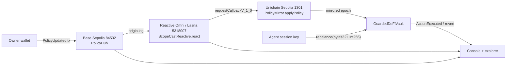
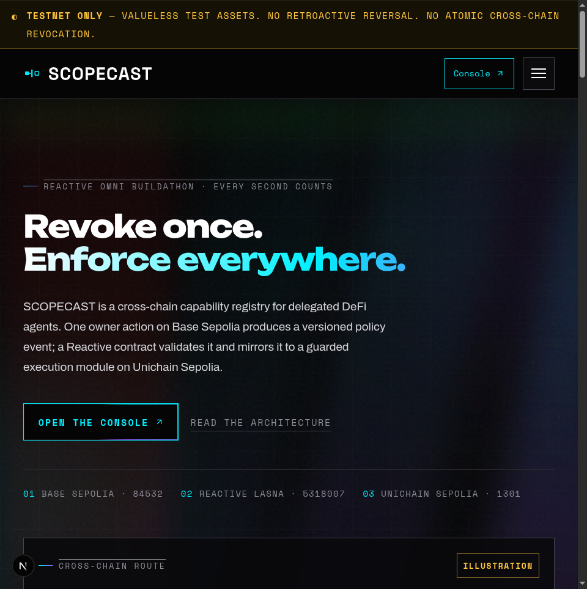
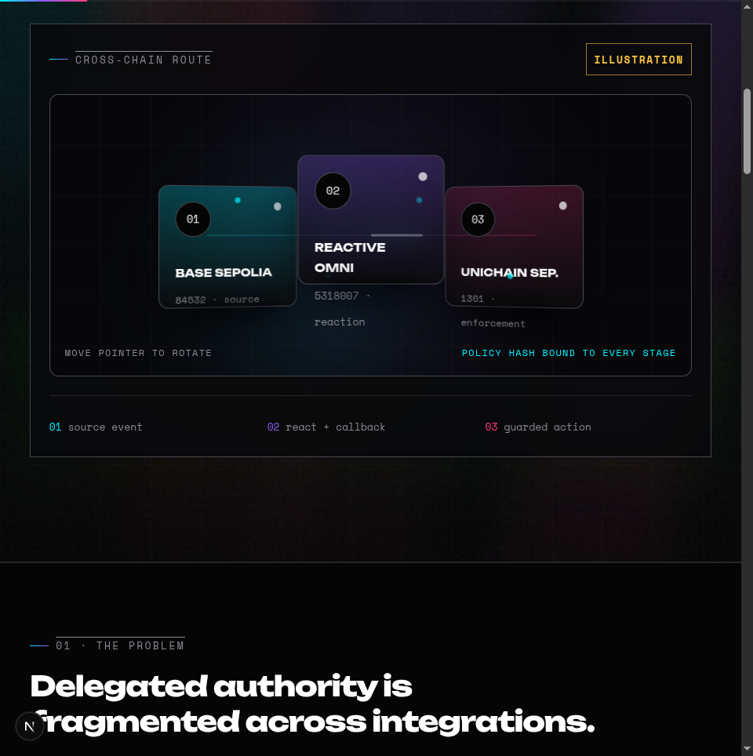
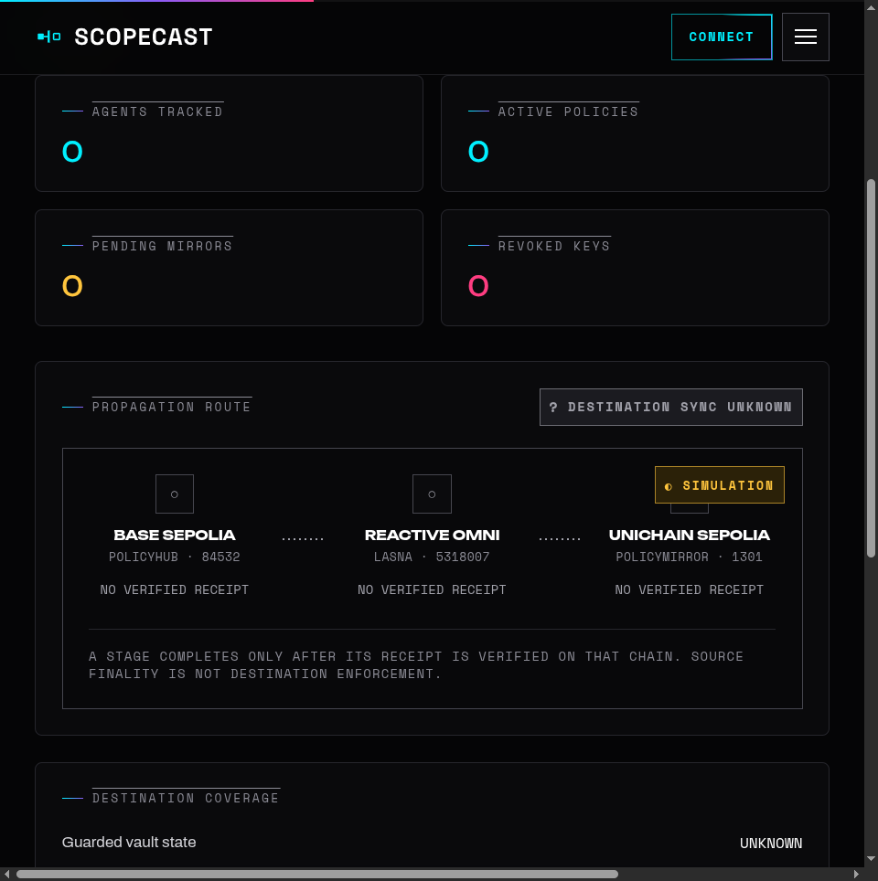
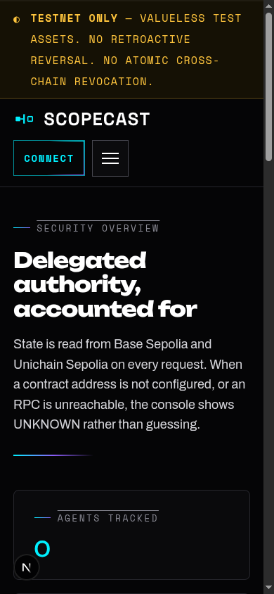

<div align="center">


**Revoke once. Enforce everywhere.**

Cross-chain, agent-scoped permission synchronisation for DeFi protocols, powered by **Reactive Omni**.

| **Live app:** [scopecast.vercel.app](https://scopecast.vercel.app/) | Testnet only | Foundry 0.8.29 | Reactive Lasna | Verified callback |
| --- | --- | --- | --- | --- |

</div>

---

## Contents

- [What SCOPECAST is](#what-scopecast-is)
- [Why it exists](#why-it-exists)
- [How the flow works](#how-the-flow-works)
- [Design and product experience](#design-and-product-experience)
- [Screenshots](#screenshots)
- [Architecture](#architecture)
- [Security model](#security-model)
- [Verified deployment](#verified-deployment)
- [Quickstart](#quickstart)
- [Repository layout](#repository-layout)
- [Documentation](#documentation)
- [Testing and quality gates](#testing-and-quality-gates)
- [Known limitations](#known-limitations)
- [Research and differentiation](#research-and-differentiation)
- [License](#license)

---

## What SCOPECAST is

SCOPECAST gives a user or protocol **one authoritative policy registry** for a delegated DeFi agent.
An owner publishes a versioned capability on Base Sepolia. A Reactive contract observes the source
event, validates it, and requests an authenticated callback that mirrors the policy into a guarded
execution module on Unichain Sepolia. The module checks that mirrored state on **every** agent call.

The demo proves a concrete, falsifiable security property:

> The agent's bounded action **succeeds before** the revoke callback is confirmed, and the **same
> action is rejected on-chain after** the newer epoch reaches the destination.

It is a coordination layer for integrated smart-contract permissions — not a smart wallet, not an
approval scanner, not a price-driven circuit breaker, and not a universal revoker.

## Why it exists

A delegated agent can hold scoped permissions in several protocol integrations and on several
chains. Each integration keeps its own local state. Revoking one session on one chain does not update
the others until someone submits a separate transaction to each of them. That creates:

- **No single control plane** — the owner must find and update every integration.
- **Operational delay** — each chain-specific update is a separate transaction.
- **No shared proof** — there is no canonical trail from a source revocation to destination enforcement.

SCOPECAST replaces that with one owner-authored policy event, one Reactive reaction, and one
verifiable callback receipt per change.

## How the flow works



**Policy fields** (all bound by one canonical hash):

| Field | Type | Meaning |
| --- | --- | --- |
| `agentId` | `bytes32` | Stable identifier, not a display name |
| `agent` | `address` | The only key allowed to call the guarded module |
| `destinationChainId` | `uint256` | Chain the policy is valid on (`1301`) |
| `destinationModule` | `address` | The only contract the agent may act through |
| `allowedSelector` | `bytes4` | The single function selector allowed |
| `maxValue` | `uint256` | Per-action ceiling |
| `expiresAt` | `uint64` | Unix timestamp after which the capability is void |
| `epoch` | `uint64` | Monotonic version; strictly newer wins |
| `active` / `policyHash` | `bool` / `bytes32` | Revocation flag and integrity hash |

`PolicyUpdated` topic0:
`0xd1601cdc83fb90b6c3071dcd453f6433b966853b9b306aeb31c20c74ebedd8c9`

Because the event has three indexed parameters plus its signature, the log has four topics
(`LOG4` / `opCode == 4`). The Reactive contract checks this before decoding.

## Design and product experience

The visual system is a high-trust security console, not a trading terminal: near-black surfaces,
white type, and restrained cyan → violet → pink gradients used as signals rather than decoration.
Full rules live in [`design-system/MASTER.md`](./design-system/MASTER.md).

**Typography** — all files are downloaded and served locally from `apps/web/public/fonts/`; nothing
is fetched at runtime:

| Role | Family | Licence | Local files |
| --- | --- | --- | --- |
| Display | **Unbounded** | SIL OFL 1.1 | `unbounded-latin-variable.woff2` |
| Interface | **Archivo** | SIL OFL 1.1 | `archivo-latin-variable.woff2` |
| Data / addresses | **Space Mono** | SIL OFL 1.1 | `space-mono-latin-400.woff2`, `space-mono-latin-700.woff2` |

**Colour and state** — `#050506` canvas, `#0B0B0D` surface, white ink, `#00F0FF` flare (active),
`#8B5CF6` iris (propagation), `#FF3D81` blush (revoked), `#FFC53D` amber (pending). Status is never
colour-only: every state carries an icon, an uppercase text label and a distinct line pattern.

**Motion and illustration**

- A locally generated looping motion background (`apps/web/public/media/aurora-loop.webm/mp4`,
  produced with FFmpeg — no network fetch) sits behind the hero.
- The hero route is a pointer-reactive **3D scene**: three depth-layered chain cards, a gradient
  signal line, a travelling pulse and glow orbs (`components/RouteScene3D.tsx`).
- Aceternity-inspired effects are implemented locally and kept subordinate to data: animated aurora
  waves, meteors, sparkles, background beams, pointer-tracked card spotlight and glare, 3D tilt,
  orbiting rings, a tracing beam, magnetic CTAs, moving-border buttons, gradient/shimmer text,
  typewriter reveal, a capability-fingerprint proof (nine field ticks converging into one hash tile,
  replicated at EMIT / RECOMPUTE / VERIFY), four information-bearing security SVG glyphs with line
  patterns, a cut-channel diagram for asynchronous finality, verification rails on the status table,
  intersection-based scroll reveals and a responsive role gallery (single-card snap rail with a peek
  on mobile, four fixed cards on desktop, no auto-advance).
- All motion respects `prefers-reduced-motion`; there is a static labelled fallback.
- Motion uses `transform` and `opacity` for movement; the only other animated property is a single `background-position` shimmer on the hero gradient text.

**Brand assets** — original vector geometry (two permission nodes joined by a controlled signal line
ending in a closed gate):

| File | Use |
| --- | --- |
| `public/brand/scopecast-mark.svg` | Icon |
| `public/brand/scopecast-wordmark.svg` | Wordmark |
| `public/brand/scopecast-lockup.svg` | Headers, README, login |
| `public/brand/favicon.svg` | Browser tab |

Identical copies are served from `apps/web/public/brand/`.

## Screenshots

| Landing hero | 3D route illustration |
| --- | --- |
|  |  |

| Console overview | Console on mobile |
| --- | --- |
|  |  |

## Architecture

| Component | Chain | Responsibility |
| --- | --- | --- |
| `PolicyHub.sol` | Base Sepolia | Owner-only registry; increments epoch and emits `PolicyUpdated` |
| `ScopeCastReactive.sol` | Reactive Lasna | Validates chain, emitter, topic0, `opCode`, destination and policy hash, then requests callback |
| `PolicyMirror.sol` | Unichain Sepolia | Authenticates proxy + reactive sender; applies strictly newer epochs; idempotent |
| `GuardedDeFiVault.sol` | Unichain Sepolia | Checks active, agent, chain, target, selector, expiry and cap on every action |
| `MockAsset.sol` | Unichain Sepolia | Valueless test ERC-20 for the demonstration |

The three-chain address cycle is resolved with an owner-only `configure(hub, module, mirror)` on the
Reactive contract: the mirror has an immutable dependency on the Reactive address, and the hub and
vault depend on each other. Chain IDs, topic0 and gas limit remain immutable.

## Security model

- **Dual callback authentication** — `onlyServiceProvider` (caller is the official callback proxy)
  and `onlyCallbackSender(reactive_)` (the injected first address argument is the authorised
  Reactive contract). Both are required.
- **Monotonic epochs** — a callback at epoch `n` is ignored if the mirror already holds `n` or
  newer. A delayed revoke cannot be overwritten by an older grant.
- **Canonical hash** — the nine-field policy hash is recomputed independently on source, Reactive
  and destination.
- **Fail-closed guard** — the vault has no arbitrary recipient or external target path.
- **Honest state language** — `SOURCE_REVOKED` is never shown as "revoked everywhere";
  `DESTINATION_REVOKED` and `DESTINATION_SYNC_UNKNOWN` are distinct verified states.

Threat-by-threat detail: [`docs/THREAT_MODEL.md`](./docs/THREAT_MODEL.md) and
[`docs/SECURITY.md`](./docs/SECURITY.md).

## Verified deployment

Network constants (re-verified 2026-11-25):

| Constant | Value |
| --- | --- |
| Reactive system contract (Lasna) | `0x8888888888888888888888888888888888888888` |
| Base Sepolia callback proxy | `0x476F44b11F5C942c58f4c8E3d0300E5710743585` |
| Unichain Sepolia callback proxy | `0x775c9B990ADe401060B78D0e98684eEf8d2466C1` |
| Reactive library | `reactive-lib-omni` v0.1.0 @ `3ade0dcf1d27e67e5783ef807e73a1b9e0c0cce8` |

Contracts:

| Contract | Chain | Address |
| --- | --- | --- |
| `PolicyHub` | Base Sepolia (84532) | `0xc8B5A34BC6791138d107E1348A24bB7c27C766e4` |
| `ScopeCastReactive` | Lasna (5318007) | `0x155c0CbEdfBA688974A7354D39797c09667f98a3` |
| `PolicyMirror` | Unichain Sepolia (1301) | `0xFd036Ad562A612cEF82db4893558C09bBA8664D8` |
| `GuardedDeFiVault` | Unichain Sepolia (1301) | `0x6AA08fD4C41D4e66CC27f654bE4f8f0e71029DBD` |
| `MockAsset` | Unichain Sepolia (1301) | `0xcfF438ec5B4AB5Afef185D5C2b270c9fFFF5fc8e` |

Full receipts and constructor checks: [`docs/DEPLOYMENTS.md`](./docs/DEPLOYMENTS.md).

Live flow evidence (all hashes independently checked with `eth_getTransactionReceipt`):

| Stage | Chain | Hash |
| --- | --- | --- |
| Source grant | Base Sepolia | `0xb8d1c99253cf7b7c737878abf0862a372aaee8db64f918ccc94c84a9e61c083a` |
| Reactive `react()` | Lasna | `0xb7ba1b7abbb21e87d97a65f445e761957be5b8acaa573432bf7e5aa869c8a1e3` |
| Destination callback | Unichain Sepolia | `0xc42a91950fa0005bd8576a73c34c2811dbe1f726f0827bc0cb10803eeeafa73c` |
| Pre-revoke agent action | Unichain Sepolia | `0x5aba6e8332a4a705278893d1f68c388c1ecd9b5dbd6df350c278809167453cf4` |
| Source revoke | Base Sepolia | `0xff1505decd47016664421af80d15369eb5b4817204ebe11dcfdce780eeafc25d` |
| Reactive revoke tx | Lasna | `0x26f412c5179d8413de903a61ccad55caae5f2addf84a9ffa5199af62cb331b91` |
| Revoke callback | Unichain Sepolia | `0x97d2a79dac850272906e637b2bc8862a39aa97b985c6fd0c9055428d0a540112` |
| Post-revoke denial | Unichain Sepolia | `eth_call` simulation, revert `0x5aff86e7` (`AgentPolicyInactive`) |

Observed propagation: **3,000 ms on the revoke path** and **2,000 ms on the grant path**, measured as
destination block timestamp minus source block timestamp from verified receipts. Machine-readable evidence:
[`apps/web/public/evidence/flow.json`](./apps/web/public/evidence/flow.json).

## Quickstart

Requirements: Foundry 1.5+, Node 22+, pnpm, and testnet ETH on Base Sepolia / Unichain Sepolia plus
lREACT on Lasna. Testnet resources only — never use mainnet funds.

**Live console:** [https://scopecast.vercel.app/](https://scopecast.vercel.app/)

```bash
git clone https://github.com/trinnode/scopecast.git
cd scopecast

# Contracts
cd contracts
forge build
forge test -vvv

# Console
cd ../apps/web
pnpm install
pnpm dev
# open http://localhost:3000
```

Configuration: copy `.env.example` to `.env` and fill only the variables you need. **Never commit
`.env` and never prefix a secret with `NEXT_PUBLIC_`.**

Server-only variable names: `DEPLOYER_PRIVATE_KEY`, `REACTIVE_DEPLOYER_PRIVATE_KEY`,
`AGENT_SESSION_PRIVATE_KEY`. Public addresses are exposed through `NEXT_PUBLIC_*_ADDRESS` variables;
see `.env.example` for the complete list.

Deployment and live-flow reproduction:

```bash
# Deploy all five contracts and configure the subscription
bash scripts/deploy.sh

# Run grant → callback → action → revoke → denial and write verified evidence
cd apps/web && pnpm flow
```

DoraHacks submission copy, the demo storyboard, captured frames and the demo video are kept locally and are intentionally not published in this repository. Step-by-step manual commands, funding and callback recovery:
[`docs/RUNBOOK.md`](./docs/RUNBOOK.md) and [`docs/CALLBACK_OPERATIONS.md`](./docs/CALLBACK_OPERATIONS.md).

## Repository layout

```text
scopecast/
  apps/web/                 Next.js App Router console
    app/                    Landing + 10 console screens
    components/             Effects, shell, wallet, route visuals
    lib/                    Config, ABIs, chain reads, evidence, formatting
    public/brand/           Served SVG identity
    public/fonts/           Locally hosted woff2 fonts
    public/media/           Locally generated motion loop
    public/evidence/        Verified receipts and deployment record
    scripts/flow.mjs        Live flow runner
  contracts/                Foundry project
    src/                    PolicyHub, ScopeCastReactive, PolicyMirror, Vault, MockAsset
    test/                   Unit, fuzz, harness and integration tests
    lib/reactive-lib/       Pinned official reactive-lib-omni source
    foundry.toml
  design-system/            Visual rules and token source of truth
  docs/                     Architecture, security, runbook, deployments, submission, screenshots
  research/                 Sourced technical and competitive research
  public/brand/             Canonical SVG brand files
  scripts/                  Deployment script
  .env.example              Variable names only — no secrets
```

## Documentation

| Document | What it covers |
| --- | --- |
| [`docs/ARCHITECTURE.md`](./docs/ARCHITECTURE.md) | Topology, trust boundaries, state machines, bootstrap sequence |
| [`docs/SECURITY.md`](./docs/SECURITY.md) | Policy semantics, callback authentication, replay rules |
| [`docs/THREAT_MODEL.md`](./docs/THREAT_MODEL.md) | Ten threats with mitigations and residual risk |
| [`docs/RUNBOOK.md`](./docs/RUNBOOK.md) | Deploy, grant, revoke, recovery, reserve top-up |
| [`docs/CALLBACK_OPERATIONS.md`](./docs/CALLBACK_OPERATIONS.md) | Proxies, gas, debt, debugging |
| [`docs/DEPLOYMENTS.md`](./docs/DEPLOYMENTS.md) | Addresses, hashes, subscription, verification commands |
| [`research/REACTIVE_TECHNICAL.md`](./research/REACTIVE_TECHNICAL.md) | Exact Omni APIs and verification |
| [`research/COMPETITIVE_LANDSCAPE.md`](./research/COMPETITIVE_LANDSCAPE.md) | Dated competitor matrix |

## Testing and quality gates

| Gate | Result |
| --- | --- |
| `forge build`, `forge fmt --check` | Pass |
| `forge test -vvv` | **51 tests passing** — unit, fuzz, replay, forged callback, local full lifecycle |
| `pnpm typecheck` | Pass |
| `pnpm build` | Pass; 11 authored screens (12 build entries including `not-found`) |
| Browser QA | 390 / 768 / 1440 px, zero horizontal overflow, no console errors |
| Live receipts | All grant, reactive, callback, action and revoke hashes checked by RPC |

No professional audit has been performed; this is a testnet hackathon build.

## Known limitations

- Revocation is asynchronous; no atomic or instant cross-chain revocation is claimed.
- Settled transactions are never reversed.
- Only modules that query `PolicyMirror` are protected.
- Callback funding exhaustion can interrupt delivery; reserve health is shown in diagnostics.
- The source owner should be a multisig or smart account in production.
- Testnet chain parameters can change; recheck official docs before redeploying.
- The callback gas limit must be large enough after proxy overhead; 800,000 gas was measured and
  used (the minimum is 100,000 and the Reactive transaction cap is 900,000).

## Research and differentiation

SCOPECAST's wedge is a **versioned capability policy authored on a source EVM registry**, mirrored
by Reactive into a destination contract that enforces it. Adjacent builds matter and are documented
honestly: Pitstop is a gas-reserve freeze, Pocket Money mirrors a remaining-budget scalar, and
Ration orders budget epochs with local spender lists. Neither was found to mirror a source-authored
capability policy with per-method enforcement. No "world's first" claim is made.

Sources, access dates and exact claims: [`research/SOURCES.md`](./research/SOURCES.md) and
[`research/SOURCES_REACTIVE.md`](./research/SOURCES_REACTIVE.md).

## License

MIT. Original brand geometry, illustrations, motion background and UI components are produced for
this project; font licences are listed in [`design-system/MASTER.md`](./design-system/MASTER.md).
