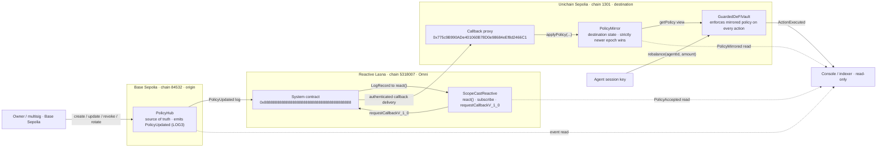
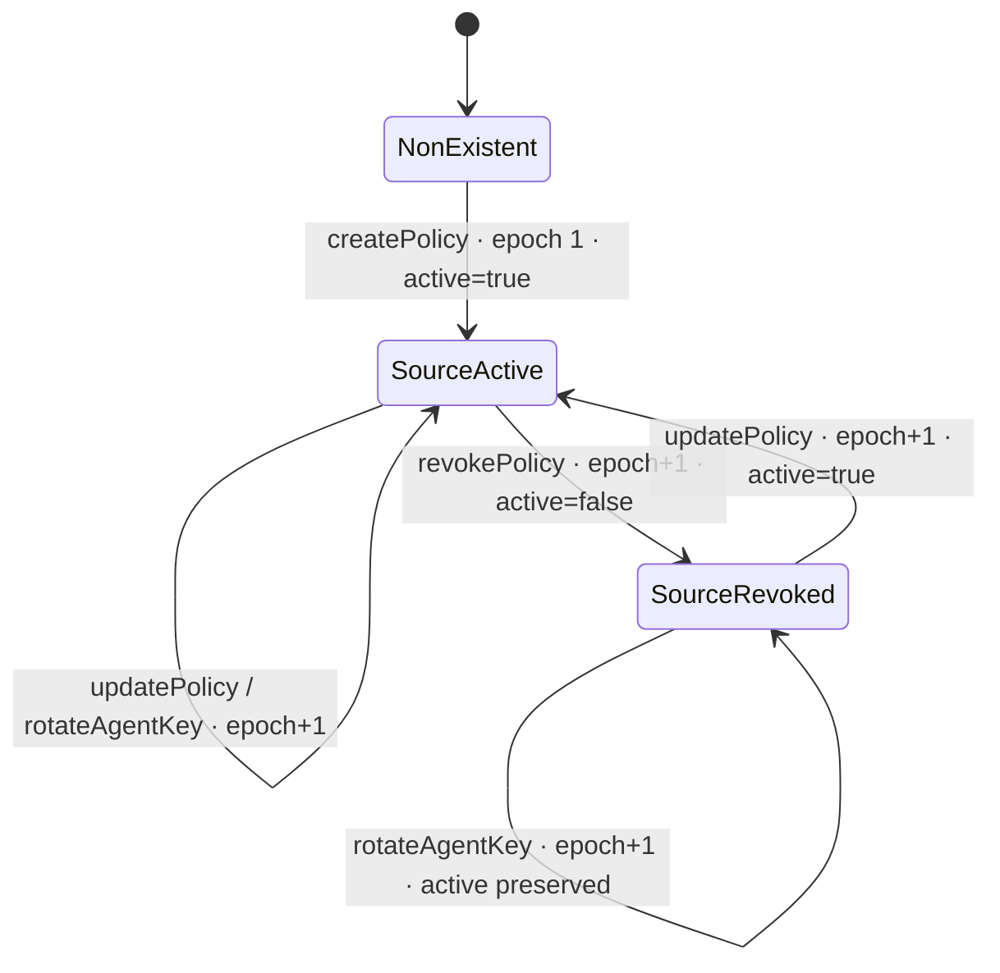
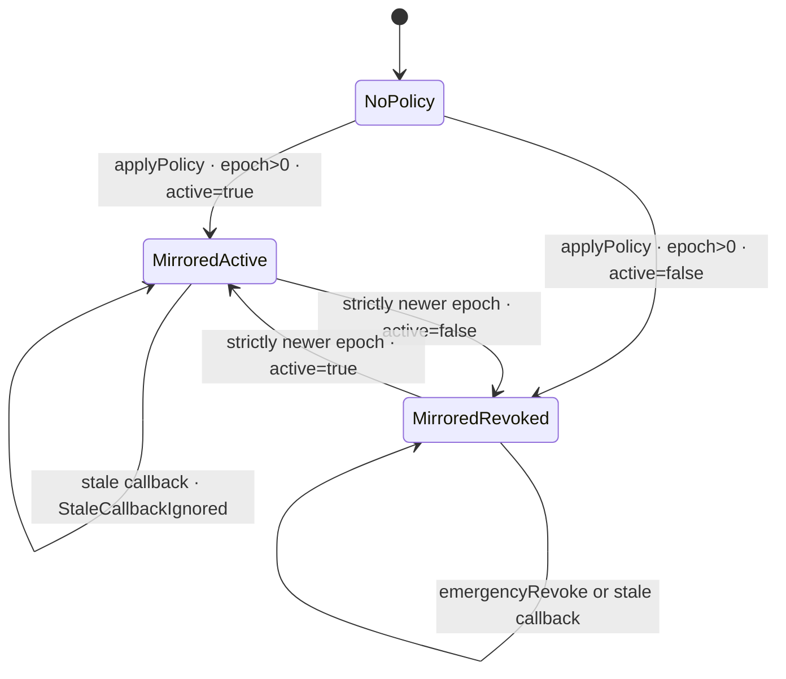

# SCOPECAST — Architecture

> Status: testnet-only build. No production deployment receipts exist yet. Every address and hash
> that is not a published network constant is written as `<PENDING_DEPLOY>` and must be filled only
> from verified RPC receipts (see `DEPLOYMENTS.md`). Local Foundry runs are **simulation**, not
> evidence of a live Reactive callback.
>
> In one sentence: one owner-authored, versioned capability policy is published on Base Sepolia; a
> Reactive contract on Lasna validates the event and requests an authenticated callback; a mirror on
> Unichain Sepolia accepts only strictly newer epochs; a guarded vault enforces the mirrored policy
> on every agent action. Propagation is **asynchronous**. SCOPECAST does not reverse settled
> transactions, is not atomic, and protects only modules that integrate the mirror.

## 1. Topology



The Base Sepolia callback proxy
`0x476F44b11F5C942c58f4c8E3d0300E5710743585` exists and is a published network constant, but the
source-side flow does not receive callbacks, so SCOPECAST does not use it. The Unichain Sepolia
proxy is the only callback gateway in the active path.

## 2. Component roles

| Component | Chain | Authoritative for | Key configuration | Mutation surface |
| --- | --- | --- | --- | --- |
| `PolicyHub` | Base Sepolia (84532) | Source policy state and epoch | `expectedDestinationChainId = 1301`, `expectedDestinationModule = <PENDING_DEPLOY>` (vault), `owner` | `onlyOwner`: `createPolicy`, `updatePolicy`, `revokePolicy`, `rotateAgentKey`, `transferOwnership` |
| `ScopeCastReactive` | Reactive Lasna (5318007) | Decision to request a callback | immutables: `originChainId = 84532`, `originHub = <PENDING_DEPLOY>`, `policyTopic0 = 0xd1601cdc83fb90b6c3071dcd453f6433b966853b9b306aeb31c20c74ebedd8c9`, `destinationChainId = 1301`, `expectedDestinationModule = <PENDING_DEPLOY>` (vault), `callbackGasLimit`; mutable owner-set `destinationMirror` | `react()` (`onlySystem`), `setDestinationMirror` / `transferOwnership` (`onlyOwner`) |
| `PolicyMirror` | Unichain Sepolia (1301) | Destination policy state and accepted epoch | immutables: callback proxy `0x775c9B990ADe401060B78D0e98684eEf8d2466C1`, authorised reactive sender `<PENDING_DEPLOY>`; mutable `admin`, `approvedModule` | `applyPolicy` (callback only), `emergencyRevoke` / `setModuleApproval` / `transferAdmin` (`onlyAdmin`), `coverDebt` (public) |
| `GuardedDeFiVault` | Unichain Sepolia (1301) | Enforcement of a guarded action | immutables: `mirror = <PENDING_DEPLOY>`, `asset = <PENDING_DEPLOY>`; mutable `owner`, `holdings`, `deployed` | `seed` / `withdraw` / `transferOwnership` (`onlyOwner`), `rebalance` (agent, guarded) |
| `MockAsset` | Unichain Sepolia (1301) | Test units only | freely mintable; testnet-only by design | `mint`, `transfer`, `approve`, `transferFrom` |

`PolicyUpdated` has three indexed fields (`agentId`, `agent`, `epoch`) and seven non-indexed fields,
in the exact decoder order used by `react()`:

```
(uint256 destinationChainId,
 address  destinationModule,
 bytes4   allowedSelector,
 uint256  maxValue,
 uint64   expiresAt,
 bool     active,
 bytes32  policyHash)
```

The event signature hash is
`keccak256("PolicyUpdated(bytes32,address,uint64,uint256,address,bytes4,uint256,uint64,bool,bytes32)")`
= `0xd1601cdc83fb90b6c3071dcd453f6433b966853b9b306aeb31c20c74ebedd8c9`. The field order is a
compatibility contract between all three contracts; changing it requires redeploying all of them.

## 3. Trust boundaries

| # | Boundary | What is trusted / how it is checked | What happens if the check fails |
| --- | --- | --- | --- |
| TB1 | Owner → `PolicyHub` (Base Sepolia) | `onlyOwner` on every mutation. The agent key is never an owner. Production owner should be a multisig or smart account. | Unauthorised policy writes revert with `NotOwner`. A compromised owner can still authorise a malicious policy (see `THREAT_MODEL.md`). |
| TB2 | Base Sepolia logs → Reactive system contract → `react()` | `onlySystem` (`msg.sender == 0x8888…8888`); plus explicit filters on `chainId`, `contractAddress`, `topic0`, `opCode == 3`, nonzero indexed values, destination chain/module, and canonical `PolicyHash`. | Fabricated or unrelated logs cannot call `react()`; irrelevant logs return silently rather than revert, because a reverted react is still billed. |
| TB3 | Reactive → Unichain callback proxy → `PolicyMirror` | Both `onlyServiceProvider` (caller is the official Unichain callback proxy) and `onlyCallbackSender(reactiveSender_)` (network-overwritten first payload word equals the immutable authorised reactive address). Hash, destination chain and module are re-verified. | Direct EOA calls revert `NotAuthorized`; a different reactive contract reverts `CallbackNotAuthorized`; wrong chain/module/hash revert. |
| TB4 | `PolicyMirror` → `GuardedDeFiVault` | The vault performs a read-only `getPolicy(agentId)` call. It cannot write policy state. Every action re-checks active/agent/chain/target/selector/expiry/cap. | Any missing or stale policy fails closed with a distinct custom error. |
| TB5 | Agent key → `GuardedDeFiVault` | `msg.sender` must equal the policy's agent address. No recipient- or target-bearing agent entry point exists; `seed`/`withdraw` are owner-only. | Wrong agent reverts `WrongAgent`; vault holdings cannot be redirected to an arbitrary recipient through the guarded function. |
| TB6 | Destination admin → `PolicyMirror` | `onlyAdmin` for `emergencyRevoke`, `setModuleApproval`, `transferAdmin`. This is a local fallback, not a substitute for the callback path. | Non-admin calls revert `NotAdmin`. An emergency revoke advances the local epoch and cannot be undone by an older callback. |
| TB7 | Owner → `ScopeCastReactive.setDestinationMirror` | `onlyOwner`, but the field is **mutable** (unlike the immutables in the mirror and vault). A compromised reactive owner can redirect callback recipients. | With a wrong recipient, callbacks go to an unauthorised address; monitor this storage slot and use a multisig owner in production. |

## 4. State machine

### 4.1 Source state (`PolicyHub`, per `agentId`)



`createPolicy` and `updatePolicy` enforce `expiresAt > block.timestamp` (`ExpiredPolicy`). `revokePolicy`
and `rotateAgentKey` deliberately do **not** enforce freshness, so a policy can still be revoked or
rotated after natural expiry. Revocation state is preserved by `rotateAgentKey`; only a fresh
owner-authorised `updatePolicy` can reactivate, at a strictly higher epoch.

### 4.2 Destination state (`PolicyMirror`, per `agentId`)



### 4.3 Console status labels

The console uses only these exact labels (from the build spec): `POLICY_DRAFT`,
`SOURCE_TX_SUBMITTED`, `SOURCE_POLICY_ACTIVE`, `SOURCE_REVOKED`, `REACTIVE_EVENT_PENDING`,
`REACTIVE_EVENT_PROCESSED`, `CALLBACK_REQUESTED`, `DESTINATION_POLICY_ACTIVE`,
`DESTINATION_REVOKED`, `CALLBACK_FAILED`, `DESTINATION_SYNC_UNKNOWN`. `SOURCE_REVOKED` is never
rendered as "revoked everywhere"; `DESTINATION_REVOKED` requires a verified destination receipt.

## 5. Ordering invariants

These are properties of the current source, each covered by a named test in `contracts/test/`.

1. **I1 — Source epoch monotonicity.** Every `PolicyHub` mutation increments the epoch by exactly
   one; `createPolicy` starts at 1. (`PolicyHub.t.sol::test_createStartsAtEpochOne`,
   `test_updateIncrementsEpochExactlyOnce`, `test_revokeIncrementsEpochAndDeactivates`.)
2. **I2 — One callback request per (agentId, epoch).** `ScopeCastReactive` forwards only when
   `epoch > latestRequestedEpoch[agentId]`, then records it before requesting. Duplicate or older
   logs produce no second request. (`ScopeCastReactive.t.sol::test_duplicateEventDoesNotRequestSecondCallback`,
   `test_oldEpochAfterNewEpochIsIgnored`.)
3. **I3 — Strictly newer wins at the destination.** `PolicyMirror` writes only when
   `epoch > storedEpoch`; equal or older callbacks emit `StaleCallbackIgnored` and return without
   reverting. (`PolicyMirror.t.sol::test_staleCallbackIgnoredWithoutStateChange`,
   `test_oldCallbackCannotReactivateRevokedPolicy`, `testFuzz_epochsAreMonotonic`.)
4. **I4 — Canonical hash binds all nine fields.** `PolicyHash.compute` is identical in the hub,
   reactive and mirror. A mismatch drops the log at the reactive layer and reverts the callback with
   `BadPolicyHash`. (`PolicyHub.t.sol::test_eventCarriesAllFieldsAndCanonicalHash`,
   `ScopeCastReactive.t.sol::test_ignoresTamperedPolicyHash`,
   `PolicyMirror.t.sol::test_tamperedHashRejected`.)
5. **I5 — Destination binding.** Hub immutables pin destination chain 1301 and the vault module;
   the reactive re-checks both; the mirror checks `destinationChainId == block.chainid` and requires
   `approvedModule[destinationModule]`. (`PolicyHub.t.sol::test_rejectsZeroFields`,
   `PolicyMirror.t.sol::test_wrongDestinationChainRejected`, `test_unapprovedModuleRejected`.)
6. **I6 — Fail closed.** An inactive or absent mirrored policy means no guarded action succeeds.
   (`GuardedDeFiVault.t.sol::test_revokedPolicyRejected`, `test_actionAfterDestinationRevokeRejected`.)
7. **I7 — Idempotent delivery.** Duplicate callbacks are harmless and do not burn the receiver's
   gas reserve on a revert. (I3 tests; `PolicyMirror.applyPolicy` stale branch.)
8. **I8 — No retroactive reversal.** A call already included before the revoke callback remains
   settled; only subsequent guarded calls are rejected.
   (`IntegrationHarness.t.sol::testFullLifecycleLocally`, local simulation only.)

## 6. Deployment bootstrap sequence

`PolicyMirror._CALLBACK_SENDER` is immutable, so the mirror must know the reactive address before it
is deployed. The reactive contract, in turn, needs the hub and vault addresses. Rather than predict
CREATE addresses from nonces, the implemented contracts use a **single owner-only bootstrap
function** on the reactive side:

```solidity
function configure(address hub_, address module_, address mirror_) external onlyOwner;
```

`configure` unsubscribes the old hub (if any), stores the three addresses and subscribes to the new
hub. Chain IDs, topic0 and the callback gas limit remain immutable. Only the designated owner can
call it; in production that owner must be a multisig.

1. Deploy `ScopeCastReactive` on Lasna with non-zero placeholder hub/module/mirror addresses. The
   constructor subscribes to the placeholder; no real policy exists yet.
2. Deploy `PolicyMirror` on Unichain Sepolia with the **actual** reactive address, the callback proxy
   `0x775c9B990ADe401060B78D0e98684eEf8d2466C1`, the admin address and `initialModule = address(0)`.
3. Deploy `MockAsset` and `GuardedDeFiVault` on Unichain Sepolia (the vault takes the actual mirror).
4. Admin calls `mirror.setModuleApproval(vault, true)`.
5. Deploy `PolicyHub` on Base Sepolia with destination chain 1301 and the actual vault address.
6. Reactive owner calls `reactive.configure(hub, vault, mirror)` — this is the only step that makes
   the subscription and callback target real.
7. Fund the reactive contract with lREACT and the mirror with Unichain Sepolia native ETH.
8. Verify `eth_getCode`, all constructor views and the subscription before publishing any policy.

`bash scripts/deploy.sh` performs steps 1–8 from a local `.env` and never prints secrets. The local
`test/IntegrationHarness.t.sol` uses stub bytecode via `vm.etch` and is explicitly a simulation, not
live proof.

## 7. Propagation paths

**Grant / update / rotate:** owner transaction on Base → `PolicyUpdated` log → system contract
delivers `LogRecord` to `react()` → all filters and hash pass → `latestRequestedEpoch` advances →
`SYSTEM.requestCallbackV_1_0` → Unichain proxy calls `applyPolicy` → mirror stores the new epoch →
vault reads it on the next guarded action.

**Revoke:** same path with `active = false`. Between the source confirmation and the destination
receipt, the destination continues to enforce the previous epoch. The console must show
`SOURCE_REVOKED` + `DESTINATION_SYNC_UNKNOWN` during that window.

**Failure / recovery:** if a callback fails or is never delivered, the source epoch has already been
consumed at the reactive layer (`latestRequestedEpoch`), so the same epoch is not requested again
automatically. Recovery options are documented in `CALLBACK_OPERATIONS.md`; the destination admin
also has `emergencyRevoke`.

## 8. Honest limits

- Asynchronous propagation; no instant, atomic or universal revocation.
- No reversal of already-settled transactions.
- Only `GuardedDeFiVault` (or another module that reads `PolicyMirror`) is protected.
- The callback receiver pays for destination execution in Unichain Sepolia native ETH; a callback to
  a contract in debt is not delivered.
- The source owner should be a multisig in production; the destination admin and reactive owner are
  privileged roles.
- `MockAsset` is a valueless testnet token and must never be deployed to a mainnet.
